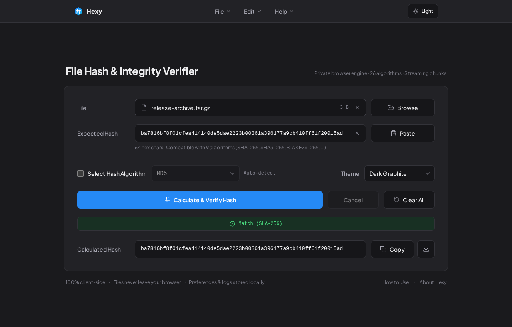
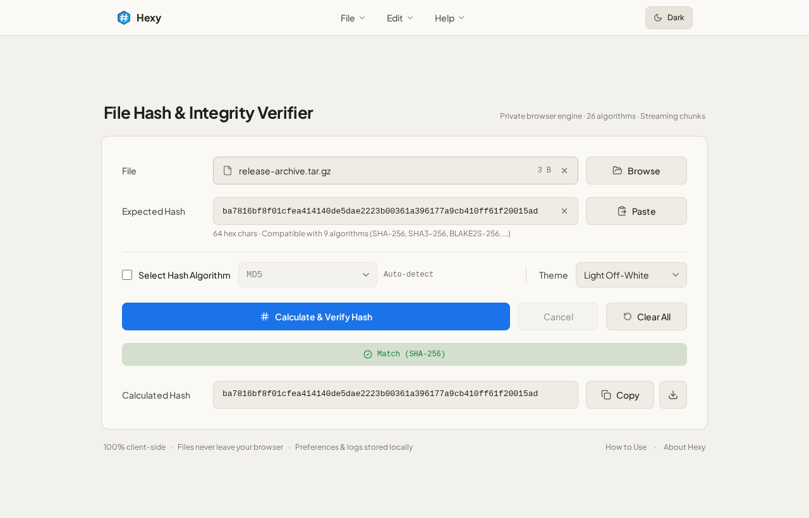

<div align="center">
  
  <h1>Hexy</h1>
  <p><strong>A fast, lightweight, privacy-first web utility for file hashing and integrity verification.</strong></p>

  <p>
    <a href="https://doctorlestrange.github.io/HexyWeb/">
      
    </a>
    <a href="https://github.com/DoctorLestrange/HexyWeb/actions/workflows/ci.yml">
      
    </a>
    <a href="https://github.com/DoctorLestrange/HexyWeb/actions/workflows/deploy-pages.yml">
      
    </a>
    <a href="LICENSE">
      
    </a>
    
  </p>

  <p>
    <strong><a href="https://doctorlestrange.github.io/HexyWeb/">Launch Hexy Web App →</a></strong>
  </p>
</div>

---

## Overview

**Hexy** computes cryptographic digests and checksums for files of any size directly inside your browser and verifies them against expected values in either **hexadecimal** or **Base64** format.

Every computation runs **100% locally** using streaming 512 KB file slices inside a dedicated Web Worker (with an automatic chunked fallback if Web Workers are restricted). Files, hashes, preferences, and activity logs **never leave your device** — zero uploads, zero external APIs, and zero telemetry.

---

## Preview

| Dark Graphite | Light Off-White |
| :---: | :---: |
|  |  |

---

## Key Features

- **26 Hash & Checksum Algorithms** — Complete coverage across SHA-2, SHA-3 & XOF, BLAKE2, BLAKE3, NIST lightweight ASCON-HASH256, legacy/ecosystem hashes, and 32-bit checksums, bit-exact with standard NIST/RFC/Bouncy Castle test vectors.
- **Auto-Detect Mode** — Uncheck **Select Hash Algorithm** and enter an expected hash to automatically test every supported algorithm matching that digest length.
- **Flexible Hash Parsing** — Accepts lowercase or uppercase hex, space-separated hex, `0x`-prefixed hex, colon-separated byte hex (`AA:BB:...`), invisible BOM/zero-width cleanup, and standard or URL-safe Base64 (both raw digest bytes and Base64-encoded ASCII hex).
- **Non-Blocking Streaming & Instant Cancellation** — Reads files in bounded 512 KB slices inside a Web Worker with live percentage progress and instant cancellation, even on multi-gigabyte files.
- **Privacy-First Local Storage** — Preferences (default theme, default algorithm, uppercase output, verification popups, activity logging) and persistent rotating logs stay strictly in browser `localStorage`.
- **Two Crafted Themes** — Switch effortlessly between **Dark Graphite** and **Light Off-White** from either the header or workspace controls.
- **Desktop-Class Ergonomics** — Full-window drag-and-drop, **File / Edit / Help** menu bar with arrow-key navigation, clipboard **Paste** / **Copy**, one-click hash export, and familiar keyboard shortcuts.

---

## Supported Algorithms (26)

| Family | Algorithms | Digest Size | Hex Length |
| :--- | :--- | :---: | :---: |
| **SHA-2** | `SHA-224`, `SHA-256`, `SHA-384`, `SHA-512`, `SHA-512/256` | 224 – 512 bit | 56 – 128 chars |
| **SHA-3 & XOF** | `SHA3-224`, `SHA3-256`, `SHA3-384`, `SHA3-512`, `SHAKE128-256`, `SHAKE256-512` | 224 – 512 bit | 56 – 128 chars |
| **BLAKE** | `BLAKE2S-128`, `BLAKE2S-256`, `BLAKE2B-256`, `BLAKE2B-384`, `BLAKE2B-512`, `BLAKE3-256` | 128 – 512 bit | 32 – 128 chars |
| **NIST Lightweight** | `ASCON-HASH256` | 256 bit | 64 chars |
| **Ecosystem** | `RIPEMD160`, `WHIRLPOOL`, `SM3` | 160 – 512 bit | 40 – 128 chars |
| **Legacy** | `MD5`, `SHA-1` | 128 – 160 bit | 32 – 40 chars |
| **Checksum** | `CRC32`, `CRC32C`, `ADLER32` | 32 bit | 8 chars |

---

## Accepted Expected Hash Formats

Hexy automatically normalizes and validates expected hashes in any of the following formats:

| Format | Example |
| :--- | :--- |
| Lowercase / Uppercase Hex | `ba7816bf8f01cfea414140de5dae2223b00361a396177a9cb410ff61f20015ad` |
| Space-Separated Hex | `BA78 16BF 8F01 CFEA 4141 40DE 5DAE 2223 ...` |
| `0x`-Prefixed Hex | `0x352441c2` |
| Colon-Separated Byte Hex | `90:01:50:98:3C:D2:4F:B0:D6:96:3F:7D:28:E1:7F:72` |
| Base64 (Raw Digest Bytes, Standard or URL-Safe) | `ungWv48Bz+pBQUDeXa4iI7ADYaOWF3qctBD/YfIAFa0=` |
| Base64 (ASCII Hex String) | `YmE3ODE2YmY4ZjAxY2ZlYTQxNDE0MGRlNWRhZTIyMjNiMDAzNjFhMzk2MTc3YTljYjQxMGZmNjFmMjAwMTVhZA==` |

---

## Keyboard Shortcuts

| Windows / Linux | macOS | Action |
| :--- | :--- | :--- |
| `Ctrl+O` | `Cmd+O` | Open file picker |
| `Ctrl+S` | `Cmd+S` | Save calculated hash to file |
| `Ctrl+,` | `Cmd+,` | Open Preferences |
| `Ctrl+L` | `Cmd+L` | View persistent activity logs |
| `Enter` | `Enter` | Calculate & Verify Hash |
| `F1` | `F1` | Open How to Use guide |
| `Esc` | `Esc` | Close active dialog or menu |

---

## Privacy & Architecture

- **Zero Network File Access**: File bytes are read exclusively via `Blob.prototype.slice().arrayBuffer()` inside the browser.
- **Dedicated Web Worker**: Hashing runs off the main UI thread in `src/workers/hash.worker.ts`, keeping progress updates smooth and cancellation immediate. If a restricted environment blocks module workers, Hexy transparently falls back to a chunked, event-loop-yielding main-thread engine.
- **Audited Cryptographic Primitives**: Built with [`@noble/hashes`](https://github.com/paulmillr/noble-hashes) plus verified pure-TypeScript streaming implementations of `ASCON-HASH256`, `SM3`, `WHIRLPOOL`, `CRC32`, `CRC32C`, and `ADLER32`.
- **Zero Telemetry**: No analytics scripts, no tracking pixels, and `<meta name="referrer" content="no-referrer">`.

---

## Local Development

### Prerequisites

- **Node.js 20+** (Node.js 22 recommended)
- **npm**

### Commands

```bash
git clone https://github.com/DoctorLestrange/HexyWeb.git
cd HexyWeb
npm install
```

| Command | Description |
| :--- | :--- |
| `npm run dev` | Starts the Vite development server at `http://localhost:3000` |
| `npm run lint` | Runs strict TypeScript type-checking (`tsc --noEmit`) |
| `npm test` | Runs the `node:test` verification suite across all 26 algorithms, parsers, preferences, and logs |
| `npm run build` | Builds the optimized static production bundle into `dist/` |
| `npm run preview` | Previews the production bundle locally |

---

## Deployment

### Automatic GitHub Pages Deployment

This repository includes [`.github/workflows/deploy-pages.yml`](.github/workflows/deploy-pages.yml), which automatically runs type-checking, executes all unit tests, builds the static production bundle, and publishes to **GitHub Pages** on every push to `main` (or via manual **Actions → Deploy to GitHub Pages → Run workflow**).

To enable GitHub Pages on your repository:

1. Go to **Settings → Pages** in your GitHub repository.
2. Under **Build and deployment → Source**, select **GitHub Actions**.
3. Push to `main` (or trigger the workflow manually) — the app will be live at `https://doctorlestrange.github.io/HexyWeb/`.

### Self-Hosting / Static Hosting

The `dist/` directory produced by `npm run build` uses relative asset paths (`./`) and requires no backend server. Upload `dist/` to any static host (GitHub Pages, Cloudflare Pages, Netlify, Vercel, Nginx, Apache, or S3).

---

## Project Structure

```text
HexyWeb/
├── .github/
│   ├── ISSUE_TEMPLATE/        # Bug report, feature request & issue chooser config
│   ├── workflows/
│   │   ├── ci.yml             # Node 20/22 type-check, test, and build verification
│   │   ├── deploy-pages.yml   # Automatic build & publish to GitHub Pages
│   │   └── release.yml        # Versioned static release archives + SHA-256 checksums
│   └── pull_request_template.md
├── docs/screenshots/          # Dark Graphite & Light Off-White previews
├── public/                    # Static assets (icon.png, .nojekyll)
├── src/
│   ├── components/            # MenuBar, Modal, Preferences, Logs, Help, About, Notice, ErrorBoundary
│   ├── utils/                 # Pure decoupled hashing engine, custom algorithms, parsers, preferences, logger & tests
│   ├── workers/               # Streaming Web Worker (hash.worker.ts)
│   ├── App.tsx                # Main utility workspace
│   ├── index.css              # Tailwind v4 design tokens (Dark Graphite & Light Off-White)
│   └── main.tsx               # App entry point wrapped in ErrorBoundary
├── index.html                 # SEO, OpenGraph, JSON-LD, theme boot script & noscript fallback
├── package.json
├── tsconfig.json
└── vite.config.ts
```

---

## Contributing & Security

- Contributions are welcome — see [CONTRIBUTING.md](CONTRIBUTING.md) for guidelines.
- Found a security issue? Please review [SECURITY.md](SECURITY.md) for private disclosure instructions.
- Release history is tracked in [CHANGELOG.md](CHANGELOG.md).

---

## Developer & License

Developed by **DoctorLestrange**.  
Licensed under the **MIT License** — see [LICENSE](LICENSE) for full details.
